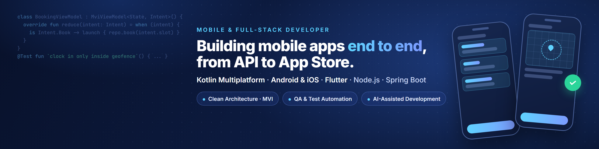

## Hi, I'm Osama 👋

I'm a **Mobile & Full-Stack Developer** in Amman, Jordan. I build mobile apps end to end: the Android and iOS app, the API behind it, the admin tools around it, and the tests that keep it all working. I also build **AI / LLM products**: real-time apps that combine speech-to-text with streaming Claude answers.

- 📱 Working mainly with **Kotlin Multiplatform**, **Jetpack Compose** and **Flutter**
- 🧠 LLM apps with **Claude** (Messages API, Claude Code CLI in headless stream-json mode), prompts grounded in real data, low-latency streaming
- 🎙️ On-device speech and ML: **whisper.cpp** on the GPU, Silero VAD, **ONNX Runtime** models for turn-end detection and voice prints
- 🤖 Agentic engineering: my own **Claude Code harness** with rules, skills, hooks, subagents, **MCP** tools and persistent memory
- 🧩 Clean Architecture, MVI / MVVM, multi-module projects
- 🧪 QA background: I write unit, UI, integration and end-to-end tests as I build, including for AI-written code
- 🚩 I ship new features behind feature flags and test them on staging first

🌐 **Portfolio:** [osama-41.github.io](https://osama-41.github.io)

---

### 🛠️ Tech stack

**Mobile**

**Backend & Web**

**AI, LLMs & Agents**

**Testing & Tools**

---

### 💼 Work highlights

> These are private client and company projects, so the code isn't public.

**🎙️ Meeting Copilot: real-time AI meeting and interview-practice assistant** · *Co-Developer* · Tauri 2, Rust, React, Claude, whisper.cpp, ONNX

A desktop copilot that listens to both sides of a call on your own PC, in Arabic and English, and uses Claude to give live notes, questions worth asking before the meeting ends, and short answers you can say out loud. No bot joins the call, and no audio is saved. I worked on the GPU speech-to-text pipeline (whisper.cpp with VAD, repeat-loop and invented-text fixes, Jordanian Arabic, priming with names from the company brief), on answers grounded in the user's CV so they never claim experience you don't have, and on warm stream-json Claude sessions that cut time to first words from 4.2 s to 3.2 s. I also did the Apple Silicon macOS port and shipped releases v0.3 to v0.7.

**🗣️ AI Interview Copilot: bilingual speech-to-answer web app** · *Contributor* · Next.js 15, Fastify, Claude, whisper.cpp, onnxruntime-web

Local GPU speech-to-text, telling the interviewer apart from the candidate with in-browser voice prints and turn-end detection, early answers drafted from partial transcripts, and answers in both English and Arabic with full RTL.

**🚗 Nextturn: UK driving-instructor marketplace** · *Main Developer* · Flutter, Node.js, MongoDB, Nuxt 3, Stripe

Turned a single-school app into a multi-tenant marketplace where instructors run their own business and learners find, book and pay for lessons. I built most of the Flutter app and the Nuxt website, a large part of the Node.js API, and Stripe Connect payments with split payouts.

**🧹 Affinity IFS: workforce management platform** · *Mobile & Full-Stack Developer* · Kotlin Multiplatform, Spring Boot, React

One shared KMP codebase (32 modules) runs a field-worker app and an admin app on Android and iOS. I built geofenced clock in and out, real-time "Go Online" presence with push notifications, automatic clock-out when a worker leaves the site, and worker self-sign-up, across the backend, the app and the admin website.

### 🤖 How I work with AI agents

I run my day-to-day engineering through a **Claude Code harness** I set up and keep improving:

- **Rules:** global and per-project instructions covering project boundaries, deploy safety checks and disk hygiene
- **Workflow skills:** frontend, backend, QA, logic tests, security and DDoS, each with a strict definition of done
- **MCP tools:** Playwright for real-browser QA, Firecrawl for web research, Context7 for current library docs
- **Memory:** file-based memory with automatic progress snapshots and a "resume point", so multi-week projects pick up cleanly in a new session
- **Hooks, subagents and task tracking** for parallel research and visible progress

The agent writes code quickly. I own the design, the review and the tests.

---

### 📫 Get in touch

Open to mobile, full-stack and AI / LLM application roles, and always happy to talk about Kotlin Multiplatform or AI agents.
