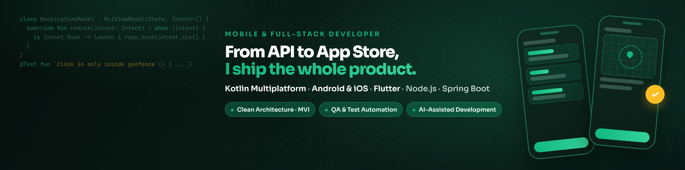

## Hi, I'm Osama 👋

I'm a **Mobile & Full-Stack Developer** in Amman, Jordan. I build mobile apps end to end: the Android and iOS app, the API behind it, the admin tools around it, and the tests that keep it all working.

- 📱 Working mainly with **Kotlin Multiplatform**, **Jetpack Compose** and **Flutter**
- 🧩 Clean Architecture, MVI / MVVM, multi-module projects
- 🧪 QA background: I write unit, UI, integration and end-to-end tests as I build
- 🚩 I ship new features behind feature flags and test them on staging first
- 🤖 I use AI-assisted development to move faster, and review and test every change

🌐 **Portfolio:** [osama-41.github.io](https://osama-41.github.io)

---

### 🛠️ Tech stack

**Mobile**

**Backend & Web**

**Testing & Tools**

---

### 💼 Work highlights

> These are private client and company projects, so the code isn't public.

**🚗 Nextturn: UK driving-instructor marketplace** · *Main Developer* · Flutter, Node.js, MongoDB, Nuxt 3, Stripe

Turned a single-school app into a multi-tenant marketplace where instructors run their own business and learners find, book and pay for lessons. I built most of the Flutter app and the Nuxt website, a large part of the Node.js API, and Stripe Connect payments with split payouts.

**🧹 Affinity IFS: workforce management platform** · *Mobile & Full-Stack Developer* · Kotlin Multiplatform, Spring Boot, React

One shared KMP codebase (32 modules) runs a field-worker app and an admin app on Android and iOS. I built geofenced clock in and out, real-time "Go Online" presence with push notifications, automatic clock-out when a worker leaves the site, and worker self-sign-up, across the backend, the app and the admin website.

---

### 📫 Get in touch

Open to mobile and full-stack roles, and always happy to talk about Kotlin Multiplatform.
